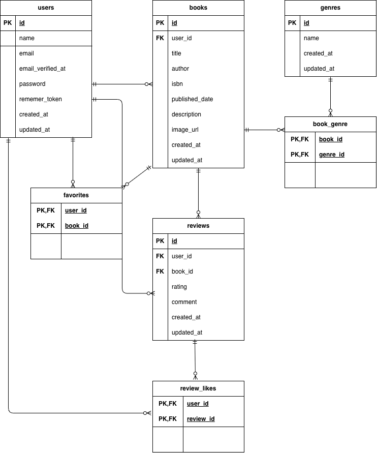
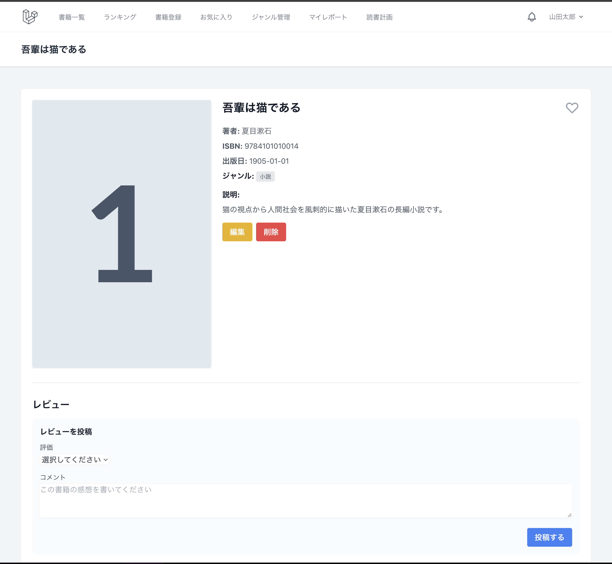
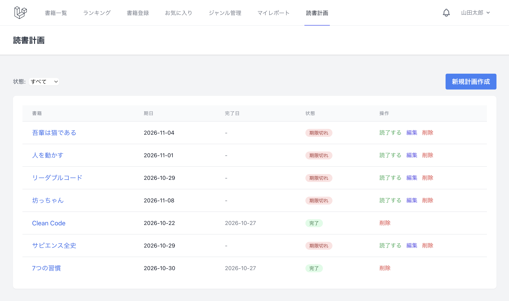
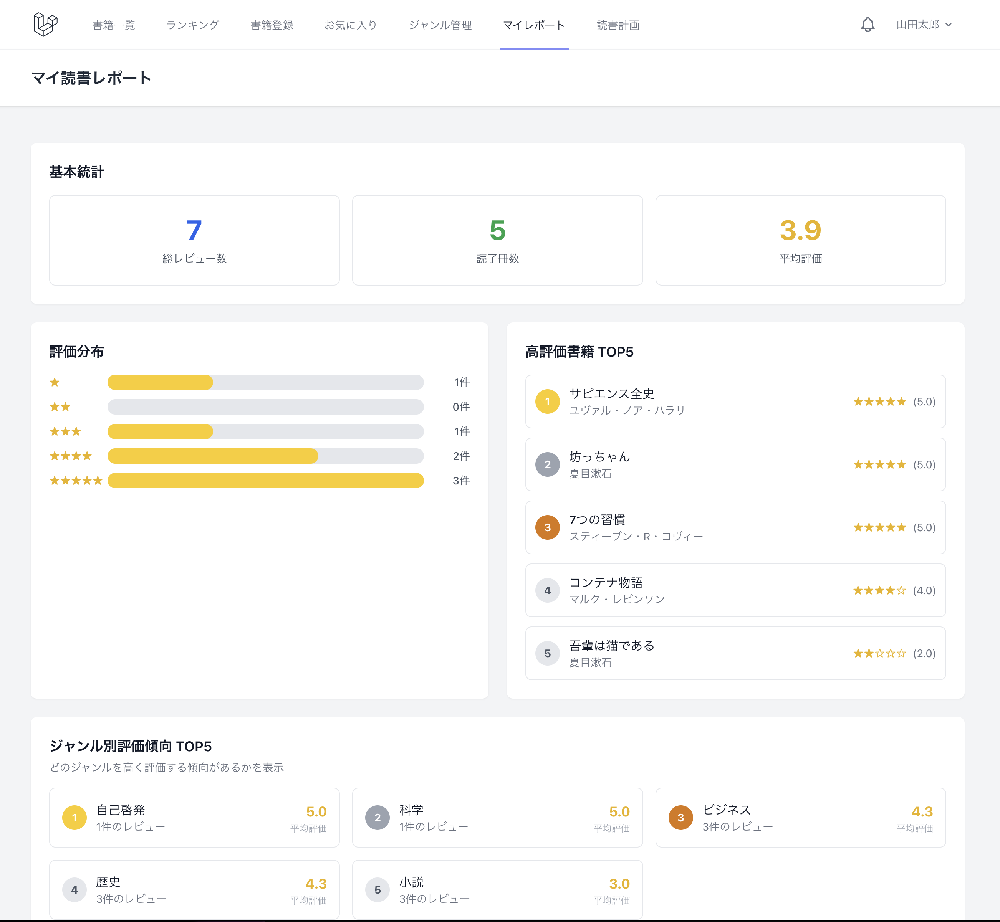

# Bookshelf

作成者：小谷野 一輝

書籍の登録・レビュー・お気に入り・ランキング・読書計画・通知・マイ読書レポートを管理するLaravelアプリケーションです。書籍登録画面ではGoogle Books APIを利用したISBN検索にも対応しています。

## 使用技術

- PHP 8.5（Laravel Sail）
- Laravel 10
- Laravel Fortify
- Laravel Sanctum
- MySQL 8.4
- Vite 5 / Tailwind CSS 3 / Alpine.js
- phpMyAdmin

Docker構成は`compose.yaml`で管理しています。

## 必要な環境

初回構築前に、次のコマンドが利用できることを確認してください。

- Git
- Docker Desktop（Docker Composeを含む）
- Composer

Node.jsとnpmはLaravel Sailコンテナ内のものを使用できます。

## 初回環境構築

以下は、新しい開発環境を作成するときだけ実行する手順です。既存のDBボリュームがある環境では「通常の起動」を使用してください。

### 1. リポジトリを取得する

```bash
git clone <repository-url>
cd bookshelf-app
```

### 2. PHPパッケージをインストールする

`vendor/`とLaravel Sailの実行ファイルを準備します。

```bash
composer install
```

### 3. 環境変数ファイルを作成する

```bash
cp .env.example .env
```

`.env`のDB設定を、`compose.yaml`のMySQLサービスと一致させます。Laravelコンテナから接続するため、`DB_HOST`にはサービス名`mysql`を指定します。

```dotenv
APP_NAME=Bookshelf
APP_ENV=local
APP_DEBUG=true
APP_URL=http://localhost

DB_CONNECTION=mysql
DB_HOST=mysql
DB_PORT=3306
DB_DATABASE=<開発用データベース名>
DB_USERNAME=<開発用ユーザー名>
DB_PASSWORD=<開発用パスワード>
```

ホスト側のポートを変更する場合は、必要に応じて次の値も`.env`へ追加します。未指定時はWebが80、MySQLが3306、phpMyAdminが8080です。

```dotenv
APP_PORT=80
FORWARD_DB_PORT=3306
FORWARD_PHPMYADMIN_PORT=8080
VITE_PORT=5173
```

ポートを変更した場合は、`APP_URL`も実際のURLに合わせてください。例えば`APP_PORT=81`なら`APP_URL=http://localhost:81`です。

### 4. Dockerコンテナを起動する

```bash
./vendor/bin/sail up -d
```

起動状態は次のコマンドで確認できます。

```bash
./vendor/bin/sail ps
```

### 5. APP_KEYを生成する

```bash
./vendor/bin/sail artisan key:generate
```

### 6. データベースを準備する

新規作成した開発DBにMigrationを適用します。

```bash
./vendor/bin/sail artisan migrate
```

要件で定義された初期データが必要な場合に限り、Migration完了後にSeederを実行します。

```bash
./vendor/bin/sail artisan db:seed
```

Seederにはユーザー、ジャンル、書籍、レビュー、お気に入り、レビューいいね、読書計画の初期データが含まれます。既存データがある環境では、内容とバックアップを確認せず実行しないでください。

### 7. フロントエンドパッケージをインストールする

`package-lock.json`に固定された依存関係をインストールします。

```bash
./vendor/bin/sail npm ci
```

### 8. Viteを起動する

開発中は別のターミナルで起動したままにします。

```bash
./vendor/bin/sail npm run dev
```

本番向けアセットを生成する場合は次を使用します。

```bash
./vendor/bin/sail npm run build
```

### 9. アプリへアクセスする

- Bookshelf: `APP_URL`に設定したURL（初期値は`http://localhost`）
- phpMyAdmin: `http://localhost:8080`（`FORWARD_PHPMYADMIN_PORT`を変更した場合はそのポート）

## Google Books APIの設定

ISBN検索にはGoogle Books APIキーが必要です。Google Cloud ConsoleでGoogle Books APIを有効化し、発行したAPIキーを`.env`へ設定してください。APIキーをGitへコミットしないでください。

```dotenv
GOOGLE_BOOKS_API_URL=https://www.googleapis.com/books/v1
GOOGLE_BOOKS_API_KEY=<取得したAPIキー>
```

環境変数を変更したあと、設定キャッシュを使用している場合は次のコマンドで消去します。

```bash
./vendor/bin/sail artisan config:clear
```

このプロジェクトではStripe連携は使用していないため、Stripe用の環境変数は不要です。

## 通常の起動

初回構築済みで、既存のMySQLボリュームと`.env`を維持したまま作業を再開する場合の手順です。

```bash
./vendor/bin/sail up -d
./vendor/bin/sail npm run dev
```

終了するときは、DBボリュームを保持する次のコマンドを使用します。

```bash
./vendor/bin/sail stop
```

`sail down -v`はDocker Volumeを削除するため、既存データを保持したい環境では実行しないでください。

依存関係の定義ファイルが更新された場合だけ、変更内容を確認して次を実行します。

```bash
./vendor/bin/sail composer install
./vendor/bin/sail npm ci
```

新しいMigrationが追加された場合は、DBバックアップと`migrate:status`を確認してから個別に適用してください。通常起動のたびにMigrationやSeederを実行する必要はありません。

### Laravel Schedulerの起動方法

本アプリケーションでは、以下の2つのCommandをLaravel Schedulerに登録しています。

| Command | 処理内容 | 実行時刻 |
|---|---|---|
| `reading-plans:expire` | 期限を過ぎた読書計画を「期限切れ」に更新 | 毎日20:00 |
| `reading-plans:remind` | 読書計画のリマインダー通知を生成 | 毎日20:00 |

タイムゾーンは`Asia/Tokyo`です。

#### 1. スケジュール登録状況を確認

```bash
./vendor/bin/sail artisan schedule:list
```

#### 2. 開発環境でSchedulerを起動

別のターミナルで以下を実行します。

```bash
./vendor/bin/sail artisan schedule:work
```

このコマンドを実行し続けることで、Laravelが毎分スケジュールを確認し、毎日20:00になると登録されたCommandを実行します。

※Laravel SailコンテナとSchedulerのプロセスが起動している必要があります。ターミナルを閉じるなどして` schedule:work`が停止すると、自動実行されません。

#### 3. Commandを手動実行する場合

期限切れ更新：

```bash
./vendor/bin/sail artisan reading-plans:expire
```

リマインダー通知：

```bash
./vendor/bin/sail artisan reading-plans:remind
```

※手動実行すると開発用DBの読書計画・通知データが実際に更新されるため、必要な場合だけ実行してください。

#### 本番環境での運用

本番環境では、Cronなどを使用してLaravelの`schedule:run`を毎分実行する構成が一般的です。開発環境の`schedule:work`とは異なり、サーバー側で継続的にスケジュールを起動する設定が必要です。

## テストの実行方法

本アプリケーションでは、PHPUnitを使用してUnitテスト・Featureテストを実施しています。

テスト用データベースにはSQLiteインメモリDBを使用し、`phpunit.xml`で接続先を設定しています。

### 全テストの実行

Laravel Sailを起動した状態で、以下を実行します。

```bash
./vendor/bin/sail artisan test
```

### 特定のテストの実行

例：書籍APIのテスト

```bash
./vendor/bin/sail artisan test --filter=BookApiTest
```

### コードスタイルの確認

Laravel Pintを使用します。

```bash
./vendor/bin/sail pint --test
```

### コードカバレッジ

PCOVなどのカバレッジドライバーが利用できる環境では、以下で計測できます。

```bash
./vendor/bin/sail artisan test --coverage
```

※カバレッジドライバーがない環境では計測できません。最終計測ではネットワーク非接続の隔離Docker環境とPCOVを使用しました。


## 主なサービスとポート

| サービス | Composeサービス名 | 初期ポート |
|---|---|---:|
| Laravel | `laravel.test` | 80 |
| MySQL | `mysql` | 3306 |
| Vite | `laravel.test` | 5173 |
| phpMyAdmin | `phpmyadmin` | 8080 |

ポートは`.env`の`APP_PORT`、`FORWARD_DB_PORT`、`VITE_PORT`、`FORWARD_PHPMYADMIN_PORT`で変更できます。

## 主要機能

- Laravel Fortifyによる会員登録・ログイン・ログアウト
- 書籍の一覧・詳細・登録・編集・削除
- タイトル・著者名のキーワード検索、ジャンル絞り込み、並び替え、ページネーション
- Google Books APIを利用したISBN検索と登録フォームへの反映
- レビューの投稿・編集・削除、レビューへのいいね
- 書籍のお気に入り登録・解除・一覧表示
- ジャンル管理と、書籍が紐付いているジャンルの削除防止
- レビュー平均評価による書籍ランキング
- 自分のレビューを集計するマイ読書レポート
- 読書計画の登録・編集・削除・読了とステータス管理
- 読書計画の期限切れ更新とリマインダー通知
- 通知一覧、未読件数表示、既読処理
- Sanctum認証を使用した書籍API

## アプリケーション設計

### MVC構成

- **Model**: `app/Models`でDBテーブルとリレーションを定義します。
- **View**: `resources/views`のBladeでWeb画面を構成します。
- **Controller**: `app/Http/Controllers`でリクエストを受け取り、Modelの取得・更新結果をViewまたはJSONとして返します。
- **FormRequest**: `app/Http/Requests`で入力ルールと日本語エラーメッセージを管理します。
- **Policy**: `app/Policies`で所有者だけに許可する更新・削除などの認可ルールを管理します。
- **Service**: `app/Services`へGoogle Books API、通知生成、通知削除などの処理を分離しています。

Controllerでは、一覧表示時にEager Loading、`withAvg()`、`withCount()`を使用し、関連データ取得時のN+1を抑制しています。マイ読書レポートではLaravel Collectionの`groupBy()`、`flatMap()`、`map()`、`sort()`、`take()`などを利用して集計しています。

### 主要Modelとリレーション

| Model | 主なリレーション |
|---|---|
| `User` | 書籍・レビュー・読書計画を複数所有し、お気に入り書籍・いいねしたレビューと多対多で関連 |
| `Book` | 登録者に属し、レビュー・読書計画を複数所有し、ジャンル・お気に入りユーザーと多対多で関連 |
| `Genre` | 書籍と`book_genre`中間テーブルを介して多対多で関連 |
| `Review` | ユーザーと書籍に属し、いいねしたユーザーと`review_likes`を介して多対多で関連 |
| `ReadingPlan` | ユーザーと書籍に属し、目標日・完了日時・Enum化した状態を保持 |

お気に入りは`favorites`、レビューいいねは`review_likes`を中間テーブルとして使用します。通知はLaravel標準のDatabase Notification形式で`notifications`テーブルへ保存します。

### 認証・認可・バリデーション

Webの書籍登録・更新・削除、レビュー、お気に入り、ジャンル、読書計画、通知、マイレポートは`auth`ミドルウェアで保護しています。書籍一覧・詳細、ランキングはゲストでも表示できます。

- `BookPolicy`: 書籍所有者だけに更新・削除を許可
- `ReviewPolicy`: レビュー投稿者だけに更新・削除を許可
- `ReadingPlanPolicy`: 所有者だけに更新・削除・読了を許可し、完了済み計画の更新を拒否
- Web用FormRequest: 書籍、レビュー、ジャンル、ISBN検索、読書計画の入力を検証
- API用FormRequest: API検索・登録・更新を検証し、422エラーをJSONで返却

読書計画では`status`や`user_id`をリクエスト値から自由に変更させず、アプリケーション側で設定します。

## 書籍API

APIのベースパスは`/api/v1`です。レスポンスは`BookResource`と`ReviewResource`でJSON形式に整形します。

| Method | Endpoint | 認証 | 概要 |
|---|---|---|---|
| GET | `/api/v1/books` | 不要 | 書籍一覧、キーワード検索、ジャンル絞り込み、ページネーション |
| GET | `/api/v1/books/{book}` | 不要 | 書籍詳細 |
| POST | `/api/v1/books` | Sanctum | 認証ユーザーを所有者として書籍登録 |
| PUT | `/api/v1/books/{book}` | Sanctum＋所有者認可 | 所有書籍の更新 |
| DELETE | `/api/v1/books/{book}` | Sanctum＋所有者認可 | 所有書籍の削除 |

書き込みAPIは`auth:sanctum`で保護され、Bearer Tokenが必要です。リクエストに`user_id`が含まれていても所有者には使用せず、認証済みユーザーのIDを設定します。非所有者による更新・削除はPolicyで403になります。

このプロジェクトにはトークン発行専用APIはありません。API確認時は、既存ユーザーに対してSanctumで安全に発行した検証用トークンを使用してください。

Postman Collectionと使用手順は`postman/`配下にあります。

## Google Books API連携

認証済みユーザーが書籍登録画面からISBN-13を送信すると、`BookController`が`GoogleBooksService`を呼び出します。ServiceはLaravel HTTPクライアントを使ってGoogle Books APIへ接続し、次の順で候補を検索します。

1. ISBN-13を指定したISBN検索
2. 変換可能なISBN-10を指定したISBN検索
3. ISBN-13による一般検索
4. ISBN-10による一般検索

返却候補の`industryIdentifiers`を照合し、入力したISBN-13または対応するISBN-10と一致した書籍だけを採用します。取得できたタイトル、著者、出版日、説明、画像URLを登録フォームへ反映し、取得できない項目は手動入力できます。

ISBN形式不正、検索結果なし、利用制限、APIキー未設定、通信障害は個別のHTTPステータスと日本語メッセージで処理します。APIキーは`config/services.php`を通じて`.env`から読み込みます。

## 読書計画・通知・バッチ処理

### ステータス管理

読書計画の状態はstring backed Enumの`ReadingPlanStatus`で管理し、Eloquent castを設定しています。DBには従来どおり次の文字列を保存します。

| Enum | DB保存値 | 表示 |
|---|---|---|
| `InProgress` | `in_progress` | 進行中 |
| `Completed` | `completed` | 完了 |
| `Expired` | `expired` | 期限切れ |

新規計画は進行中で作成され、読了操作で完了になります。期限切れ計画の目標日を変更すると進行中へ戻ります。完了済み計画の目標日は変更できません。

### CommandとSchedule

| Command | 処理 |
|---|---|
| `reading-plans:expire` | 目標日を過ぎた進行中の計画を期限切れへ更新 |
| `reading-plans:remind` | 期限3日前・当日・3日後のリマインダー通知を生成 |

両CommandはLaravel Schedulerへ毎日20:00、`Asia/Tokyo`で登録されています。登録順は期限切れ更新、リマインダー通知の順で、どちらも`withoutOverlapping()`により同時実行を抑止します。

期限3日前と当日は進行中、期限3日後は期限切れの計画を通知対象とし、完了済み計画は対象外です。通知IDは読書計画ID・目標日・通知タイミングから決定的に生成し、Command再実行時の重複通知を防止します。

読書計画または書籍をEloquent経由で削除すると、Observerと`ReadingPlanNotificationCleaner`が対象計画のリマインダー履歴を削除します。

## Database Transaction

複数テーブルへの書き込みを一単位として扱うため、次の処理で`DB::transaction()`を使用しています。

- Web書籍登録: `books`への登録と`book_genre`へのジャンル紐付け
- Web書籍更新: 書籍情報の更新とジャンルの`sync()`
- API書籍登録・更新: 書籍情報とジャンル紐付けの同時更新
- `ReadingPlanSeeder`: 前提データの確認と6件の読書計画作成

途中の処理で例外が発生した場合は、書籍だけが保存されてジャンルが未登録になる、といった不整合を防ぐため全操作をロールバックします。

## テスト構成とカバレッジ

- `tests/Unit`: Modelのリレーション・cast、Policy、設定値、バリデーション定義
- `tests/Feature`: Web画面、認証・認可、CRUD、API、外部APIモック、Command、Scheduler、通知、Migration、Seeder
- DBを利用するテスト: `RefreshDatabase`とSQLiteインメモリDBを使用
- 外部APIテスト: `Http::fake()`でGoogle Books APIをモック
- コードスタイル: Laravel Pint

2026年11月10日に、ネットワーク非接続DockerとPCOVで`app/`配下を計測した実績は次のとおりです。

| 項目 | 結果 |
|---|---:|
| PHPUnit | 271 PASS / 0 FAIL / 2 Deprecated / 1,009 Assertions |
| 行カバレッジ | 91.66%（835 / 911） |
| メソッドカバレッジ | 88.65%（125 / 141） |
| クラスカバレッジ | 77.19%（44 / 57） |

## 設計資料

### ER図



### 画面キャプチャ

#### 書籍一覧画面


#### 書籍詳細画面



#### 読書計画画面



#### マイ読書レポート画面

